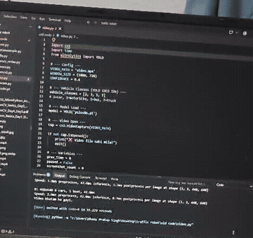

<div align="center">

# 🚦 Traffic Robot

**Smart Traffic System — real-time vehicle detection & counting with YOLOv8 and OpenCV**

*Hands-on workshop project — Dept. of Electronics & Communication Engineering,
Acropolis Institute of Technology and Research*




</div>

---

## 📖 About

This project was built during the **Smart Traffic System (Traffic Robot) workshop** conducted by the
**E-Skills Web** team for the **ECE Department of Acropolis Institute of Technology and Research**.

The repository follows the workshop from zero to a working system: **Python basics → OpenCV →
YOLOv8 vehicle detection**, plus **ESP32 / MicroPython traffic-light simulations** in Wokwi as a
bridge to real hardware. All code in this repository has been tested by the author.

### What it can do

- ✅ Detect objects in a single image (class, confidence, bounding box)
- ✅ Detect **cars, motorcycles, buses and trucks** in video, frame by frame
- ✅ Show live **FPS** and **vehicle count** on screen
- ✅ Pause / resume and take **screenshots** while the video plays
- ✅ **Track** vehicles with unique IDs to count how many passed
- ✅ Save the annotated result as an image or video

> 🎥 A recording of the vehicle detector (`workshop/day5_yolo/video.py`) running on a laptop is in
> [`demo/working_demo.mp4`](demo/working_demo.mp4).

---

## 📁 Project Structure

```
traffic-robot/
├── src/                        # Clean, ready-to-run scripts (CLI options, auto paths)
│   ├── common.py
│   ├── 01_setup_check.py       # verify install + load model
│   ├── 02_detect_image.py      # detection on an image
│   └── 03_detect_video.py      # real-time video detection / tracking
├── workshop/                   # Original day-wise workshop code (as written in class)
│   ├── day1-2_python/          # Python basics
│   ├── day3-4_opencv/          # OpenCV: images, webcam, drawing
│   ├── day5_yolo/              # YOLOv8 detection + live vehicle counting
│   └── bonus_projects/         # air-drawing canvas, hand-gesture control
├── esp32_wokwi/                # ESP32 + MicroPython traffic-light activities (Wokwi)
├── docs/                       # Workshop PDFs (Hinglish notes)
├── models/yolov8n.pt           # Pre-trained YOLOv8 nano weights
├── data/images/, data/videos/  # Sample traffic images and videos
├── demo/working_demo.mp4       # Screen recording of the working project
├── assets/                     # Images used in this README
├── requirements.txt            # core dependencies
├── requirements-extras.txt     # only for the gesture bonus projects
└── LICENSE
```

---

## 🗓️ Workshop Roadmap Covered

| Day | Topic | Code | Notes |
|---|---|---|---|
| 1-2 | Python fundamentals: variables, conditions, match-case, lists, dicts, loops | [`workshop/day1-2_python`](workshop/day1-2_python) | [`Python_Basics_Day1_Day2.pdf`](docs/Python_Basics_Day1_Day2.pdf) |
| 3-4 | OpenCV: images, BGR/RGB, resize, webcam, shapes, text, keyboard controls | [`workshop/day3-4_opencv`](workshop/day3-4_opencv) | [`OpenCV_Basics_Day3_Day4.pdf`](docs/OpenCV_Basics_Day3_Day4.pdf) |
| 5 | YOLOv8: load model, read detections, draw boxes, live vehicle counter | [`workshop/day5_yolo`](workshop/day5_yolo), [`src/`](src) | [`OpenCV_Day4_Day5.pdf`](docs/OpenCV_Day4_Day5.pdf) |
| Bridge | ESP32 + MicroPython in Wokwi: LED, traffic light, emergency override, dual-lane logic | [`esp32_wokwi`](esp32_wokwi) | [`ESP32_MicroPython_Activities.pdf`](docs/ESP32_MicroPython_Activities.pdf) |
| Bonus | Air-drawing canvas (colour tracking), hand-gesture detector and controller | [`workshop/bonus_projects`](workshop/bonus_projects) | — |

---

## 🚀 Getting Started

### 1. Clone the repository

```bash
git clone https://github.com/bhanurajpoot04/traffic-robot.git
cd traffic-robot
```

### 2. (Optional) Create a virtual environment

```bash
python -m venv venv
venv\Scripts\activate        # Windows
source venv/bin/activate     # Linux / macOS
```

### 3. Install dependencies

```bash
pip install -r requirements.txt

# only if you want the gesture bonus projects
pip install -r requirements-extras.txt
```

### 4. Run it

Run all commands from the **repository root**.

```bash
# Check that everything is installed
python src/01_setup_check.py

# Detect objects in an image (saves outputs/detected.jpg)
python src/02_detect_image.py --image data/images/traffic.jpg

# Real-time detection on a video
python src/03_detect_video.py --source data/videos/video.mp4
```

---

## 🎮 Video Script Options

| Option | Description | Default |
|---|---|---|
| `--source` | Video file path, or `0` for webcam | `data/videos/video.mp4` |
| `--conf` | Confidence threshold (0–1) | `0.4` |
| `--width` | Display width in pixels (`0` = original) | `1080` |
| `--track` | Enable tracking and count unique vehicles | off |
| `--save` | Save annotated video to `outputs/` | off |
| `--no-show` | Run without opening a window | off |

**Keyboard controls**

| Key | Action |
|---|---|
| `Space` | Pause / resume |
| `s` | Save a screenshot |
| `q` or `Esc` | Quit |

**Examples**

```bash
python src/03_detect_video.py --source data/videos/traffic.mp4 --track
python src/03_detect_video.py --source data/videos/video2.mp4 --conf 0.5 --save
python src/03_detect_video.py --source 0          # live webcam
```

---

## 🧠 How It Works

1. **Load model** – `YOLOv8n` (nano) is the smallest and fastest YOLOv8 variant, ideal for laptops without a GPU.
2. **Read frames** – OpenCV reads the image or video frame by frame.
3. **Detect** – YOLO returns bounding boxes, class IDs and confidence scores.
4. **Filter vehicles** – only COCO classes `2 (car)`, `3 (motorcycle)`, `5 (bus)` and `7 (truck)` are kept.
5. **Draw & display** – boxes, FPS and counts are drawn on the frame and shown in a window.

> 💡 Cars far away or heavily overlapping (like dense traffic jams) can be
> missed by the nano model. For better accuracy try `yolov8s.pt` or
> `yolov8m.pt` — Ultralytics downloads them automatically when you pass
> `--model yolov8s.pt`.

---

## 🛠️ Tech Stack

- [Python](https://www.python.org/) 3.10+
- [Ultralytics YOLOv8](https://docs.ultralytics.com/)
- [OpenCV](https://opencv.org/)
- [MediaPipe](https://developers.google.com/mediapipe) (gesture bonus)
- [Wokwi](https://wokwi.com/) + MicroPython on ESP32 (hardware simulation)

---

## 🔮 Future Ideas

- [ ] Lane-wise vehicle counting (North / South / East / West)
- [ ] Automatic signal timing from vehicle count (e.g. `green_time = 10 + count * 2`)
- [ ] Count vehicles crossing a virtual line (in / out)
- [ ] Estimate vehicle speed
- [ ] Smart traffic-light logic based on vehicle density
- [ ] Run on Jetson Nano and drive real traffic lights through GPIO (same logic as the ESP32 activities)
- [ ] Train on a custom dataset for local vehicles (auto-rickshaws, etc.)

---

## 🙏 Acknowledgements

- **E-Skills Web** — for conducting the Traffic Robot workshop
- **ECE Department, Acropolis Institute of Technology and Research** — for hosting it
- [Ultralytics](https://github.com/ultralytics/ultralytics) — YOLOv8
- Sample images/videos are used for educational purposes only

## 👤 Author

**Bhanu Pratap Singh Rajpoot** — [@bhanurajpoot04](https://github.com/bhanurajpoot04)

## 📄 License

This project is licensed under the MIT License — see the [LICENSE](LICENSE) file.
